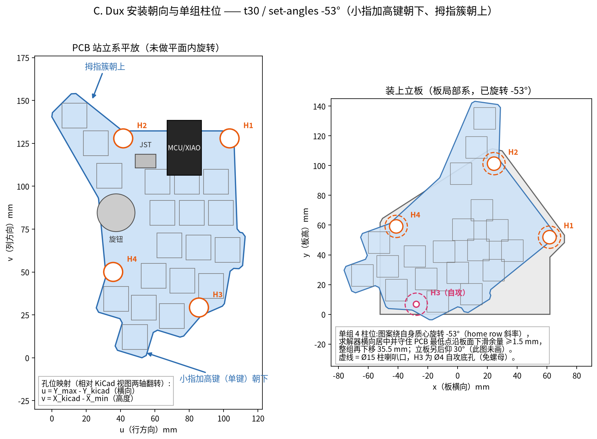
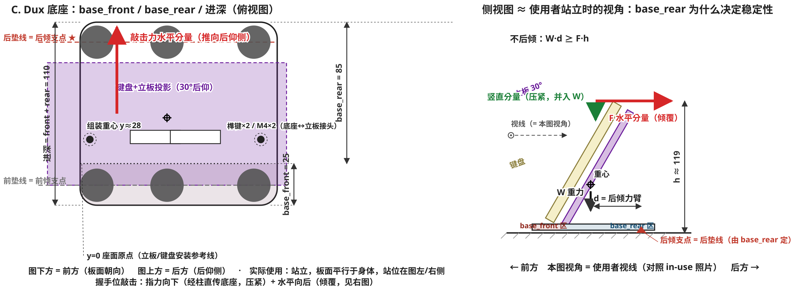

# C. Dux 垂直站立底座

`stand.py` 是垂直站立底座的 Python/build123d 实现。要点:

- 默认导出 **STL**(切片用),`--step` 加导 STEP —— STEP 是嘉立创等
  代打服务的首选格式
  (精确 B-rep,非网格近似);
- B-rep 圆角:底座顶面周边 2 mm 圆角(OpenSCAD 做不到);
- **两件式**:底座与立板(背板+柱+靴座)拆成两个零件,榫键 + 2×M4 螺丝
  连接——底座跟随柱位需求的底带足迹,立板底带与靴座齐平、底部无侧向
  悬出(靴座每侧内缩 2 mm,坐在底座顶面平直区内,避开周边 2 mm 圆角),
  试不同后仰角
  只换立板件(柱位布局不变时底座通用)
  (`--tilt`,当前默认 30°、配 `--set-angles -45`);
- **孔位/板框不手抄**:每次运行直接从 `pcb/v2.0/c-dux.kicad_pcb` 解析
  4 个 M4 孔坐标与板框尺寸,并与已验证的孔位表断言(±0.05 mm)。
  PCB 改版后若不一致,脚本拒绝出图——底座与板子不会悄悄失配。

## 设计:垂直(dodo 式)站姿

面向**站立使用**:手臂自然垂下,手掌侧向,手指沿列方向卷曲按键。因此:

- **列竖直**:小指加高键(单键)朝下、三键拇指簇朝上(与 Dodo 等
  垂直键盘一致,孔位映射见下节);
- 后仰角 `tilt`(默认 30°;照片实测站立舒适姿约 20–30°,换角度只
  重打立板,见"两件式结构"一节);
- 旋钮(encoder)随拇指簇位于站姿上部、正对使用者,正好当音量键用;
- MCU/XIAO、JST、USB 出线都在背板中上部:USB 线从侧面引出,不碰
  背板和底座;
- 裸板使用:PCB 由 4 根柱子架在背板前——**4 颗螺丝固定:3 颗 M4
  螺钉+螺母夹紧,最低孔位为 Ø3.8 自攻底孔、用 M4 自攻螺丝直接拧入
  (免螺母,为什么这样设计见“装配”一节;该柱的 Ø15 喇叭口足环虽越过
  板底缘 ~1.2 mm,现在由靴座前斜面——与板面共面——承载,四柱喇叭口
  一致;靴座前伸埋唇之前此处只能打直壁 Ø10)**,`post_h`(默认
  3 mm)保证背面的轴座/焊点/连接件不碰到背板;键帽朝向使用者一侧;
- 抗后倾不靠配重:底座向后仰侧延伸(`base_rear` 85 mm)拉长力臂
  (见"键盘离台高度与底座尺寸"一节),默认无硬币槽等配重件。

## 安装朝向(单键区朝下,拇指区朝上)

键盘装上底座的方向:**小指加高键(单键)朝下、三键拇指簇朝上**。
孔位映射据此翻转(`u = Y_max - Y_kicad`,`v = X_kicad - X_min`),因此
MCU/XIAO、JST、USB 出线位于背板中上部。

背板只有**一组 4 孔柱位**(图案绕自身质心旋转 -45° 后由求解器定位,
见下节)。下图左:PCB 站立系平放,安装孔 H1–H4 与部件位置;右:装上
立板后的板局部系,真实板框轮廓 + 柱位(H3 为 Ø3.8 自攻底孔,免螺母)。



## 安装孔位与背板高度(单组)

背板上只有 **1 组 M4 柱位**:同一 4 孔图案绕图案质心旋转一个角度
(默认 -45°,`--set-angles` 可改,负值 = 反方向倾斜)——这个平面内
旋转角就是 home row 的倾斜度,手腕前倾越多取越大角度;换角度需
重打立板。注意平面内旋转角也改变柱位布局:底带、榫键、接合螺孔
随之平移(−40 → −45 时底带左缘外移 2 mm、键位/螺孔移 1–2 mm),
**底座同样要重打**,底座与立板需成对使用。

- 柱位由求解器自动排布:横向居中,并求最小抬升,保证 **PCB 最低材料点
  (按 Edge.Cuts 实际板框逐角度采样,非包围盒角点——右下角 bbox 角处
  没有板料)距底座顶面 ≥2 mm**;整组柱位再沿背板整体下移
  `keyboard_drop` 30 mm(用户要求“键盘下移 3cm”)。最低孔位改为
  自攻底孔(lowest_post_tapped,见“装配”一节)后,下移不再受螺母
  沉孔 vs 靴座的操作限制,
  净下移由高度约束逐角度自动封顶:约束绑定时求解器把图案回抬
  以守住 2 mm 底线(t30/−35 回抬 ~0.9,净下移 ~29.1,日志
  `lowest PCB outline point z = 8.00`);当前默认 t30/−45 不触发
  回抬,净下移取整 30、`lowest PCB outline point z = 9.80`,
  见“键盘离台高度与底座尺寸”一节;
- **背板高度按需取**:立板只需在竖直方向上覆盖"螺丝孔 → 桌面"的
  投影距离并留余量(`top_rim`,5 mm,压在最高柱顶之上)——PCB 高于
  最高螺孔的部分悬出于背板之外,由 4 根柱悬臂承托;
- **背板轮廓收腰**:PCB 悬在柱前端、从不接触板面,所以肋带以上的
  轮廓自动收缩为“柱位包络的凸包”——只需包住 4 根柱(柱心外扩
  10 mm)和柱间腹板,底部保留收窄的底带(每侧只按最外柱的实际
  包络取宽、偶数 mm 取整,再收进靴座足迹——立板底带与靴座底部
  完全齐平、底角无侧向悬出;靴座、榫槽、螺
  母座、肋的立足都在这里;柱位外摆越出底带时,只保留 45° 直线肩
  的局部凸台(两条直线取代旧四分之一圆角;下肩抬高到与顶角切割线
  越环量对称,用户定稿;顶角切割线两端共 4 条板厚棱倒 r3.5 圆角,
  手感更好),如 30°/−45° 姿态)。底座足迹跟随柱位需求的原始底带
  (非对称,比立板底带每侧宽 2 mm,见“两件式结构”)。
  顶部两角再按用户草图用两条单一直线
  各切一刀(锐角):每条线 = 顶柱→侧柱线段向外平移 9.5 mm(喇叭口
  Ø15 半径 7.5 + 外留 2 mm,边界从每个柱心外 9.5 mm 通过;首版
  7 mm 会削到喇叭口环台),左线从
  顶柱(H2)直连最左柱(H4)、右线直连最右柱(H1),无多段切割;
  两线间留一条盖住顶柱凸台的顶帽(凸台顶处 ~10 mm 宽,向上收尖),
  立板再省 ~5.5 cm³(97.3 → 91.8);切线锚在柱位上随布局走,并断言
  到每个柱心的垂直距离 ≥6.5 mm(螺母沉孔对角半径 4.16 + 壁余量;
  顶柱/侧柱到本侧线恰为 7.0 = 设计值),以及顶柱凸台顶处
  顶帽 ≥8 mm,否则报错退出——布局改动不会悄悄切到螺母沉孔。
  收腰不碰任何装配
  特征,20° 立板
  省 ~16 cm³(PA12 约 −16 g);
- **腹板减重孔:已移除**(曾自动布 Ø52 孔,省料 ~12.7 cm³):站立
  打印姿态下孔顶近乎水平,等于 ~52 mm 的桥接,拖累打印成功率,故
  整体删除;省料仍由轮廓收腰承担;
- 加强肋(厚 14 mm、根部深 26 mm,沿背面升高 70 mm,每颗接合螺丝内侧一根、位置
  自动求解;避让柱背面沉孔/过孔与榫键条,且只落在靴座内、不再反向
  加宽);当前 30°/−45° 布局:右侧全高肋 x = 44;左全高肋放不下
  (初位 −34,撞 H4 背面螺母沉孔避让区),自动回退**短肋**
  x = −34、h = 50——楔顶止于 H4 沉孔口下缘之下,不挡螺母放入,
  也无需与右肋对称(用户定稿,见下);

## 环境(uv)

```sh
cd case/build123d
uv sync          # 创建 .venv,按 uv.lock 安装(build123d 0.11.1)
```

## 用法

```sh
uv run stand.py --part base                # 底座(足迹跟随底带,随布局导出)
uv run stand.py --part upright             # 左立板,30° 后仰
uv run stand.py --side right --part upright
uv run stand.py --part upright --tilt 10,15,20,25,30   # 一批角度的立板
uv run stand.py --part upright --flange 8   # 立板加可掰法兰(黏板保险)
uv run stand.py --part full                # 装配预览(两件布尔并,左半)
uv run stand.py --part joint               # 配合试块(先打这个!)
uv run stand.py --part fit                 # 平板验证件(旧,柱位实配用)
uv run stand.py --set-angles -45           # 安装组平面内旋转角(默认 -45)
```

输出到 `out/`:`stand_base.*`(底座,按当前布局导出)、
`stand_<side>_upright_t<角度>.*`(立板)、`stand_<side>_full_t<角度>.*`
(装配预览)、`joint_coupon_base.*` / `joint_coupon_boot.*`(配合
试块,两个独立文件,各自平放即打印姿态)。默认只导出 STL(切片用),加
`--step` 同时导出 STEP——代打服务的首选格式(精确 B-rep,非网格近似)。
终端打印包围盒、体积与估重(实心体积;FDM 有填充时实际更轻)。默认行为 =
**只导出文件**;想实时预览加 `--show`(推送 OCP CAD Viewer、不导出文件)。
查看器没开或半开只打印一行提示,文件产出不依赖查看器。

| 参数 | 默认 | 说明 |
|---|---|---|
| `--part` | `full` | `base` 底座 / `upright` 立板 / `full` 装配预览 / `joint` 配合试块 / `fit` 平板验证件 |
| `--tilt` | `30` | 立板/装配预览的后仰角(度),逗号分隔可批量出图 |
| `--side` | `left` | 左/右半(底座足迹随布局非对称,当前按左布局导出) |
| `--set-angles` | `-45` | 安装组的平面内旋转角(度) |
| `--post-h` | 3 | 柱高 = PCB 与背板间隙 |
| `--attach` | `nut` | `nut` 背面螺母沉孔 / `tap` 自攻(仅 PCB 柱位) |
| `--flange` | `0` | 靴座四周可掰法兰,值 = 外伸宽度(mm);底板黏性不足的保险,打印后掰掉 |
| `--show` | — | 只推送到 OCP CAD Viewer 预览,不导出文件 |
| `--pcb` | `pcb/v2.0/c-dux.kicad_pcb` | 孔位与板框来源 |
| `--out` | `out/` | 输出目录 |

其余几何参数(背板/底座/筋条/胶垫/连接件尺寸)是 `stand.py` 顶部的
模块常量,改源码即可调整;其中 `boot_inset`(靴座每侧内缩量)
= `base_top_fillet` = 2 mm——靴座完全坐在底座顶面平直区内,避开周边
2 mm 圆角;立板底带亦钳制至此足迹、与靴座齐平。交互预览:VS Code 装
**OCP CAD Viewer** 插件,面板 Open Viewer 后运行本脚本即实时显示
(推送走 dev 依赖 `ocp-vscode`,每次推送自动取景);没开查看器时,
把 `out/*.step` 拖进任何 CAD 查看器也可以。

## 两件式结构:共享底座 + 按角度换装立板

底座(足迹**精确跟随柱位需求的底带**,约 118 × 110 × 6 mm,非对称;
立板不再侧向凸出,其靴座每侧内缩 2 mm——完全坐在底座顶面 2 mm 圆角
内的平直区,立板底带钳制到靴座足迹、底部与靴座**完全齐平**(旧“板
底带刻意悬出靴座 2 mm”已废除);靴座**前立面就是立板前表面的自然
延伸**(`boot_front` = −板厚/cos(tilt),逐倾角派生,t30 趾部
−6.93 mm):斜面从座面趾部平行于立板前脸一路上顶,在靴座顶高度恰好
落回板前脸上——底边埋进实体、到键盘区一条连续表面无台阶,与 PCB
底面的间隙恒为 post_h 3 mm,底部垫高台面完整(仅靴座棱柱跟随此值;
托肩/肋仍锚背板背面,见下);最低位自攻螺丝孔尾端由托肩趾部包裹、
底孔重切穿透靴座实体(螺尾多得 ~1 mm 塑料咬合);
厚 6 与前裙边 `base_front` 25 是省料刀——前向只有拉拽/碰撞的偶发
载荷,打字主工况的后倾力臂全在 `base_rear` 85 里;胶垫随外轮廓外移,
补回倾覆支点力臂)与立板(背板 + 4 柱 + 靴座)拆成两个零件,目的是
**柱位布局不变时底座通用**,试不同后仰角只重打立板:

- **底座需随本版重打**:宽度 132.5 → ~114(t30/−45 布局实测 118;底座改为精确跟随柱位
  需求的底带足迹,消除旧全宽靴座 ~14 mm 的侧向凸出),接合螺丝孔位改
  为由靴座缘派生(靴座 = 底座足迹每侧内缩 `boot_inset` = 2 mm,立板
  底带与靴座齐平,外缘完全落在底座顶面
  2 mm 圆角内的平直区):±58 → 靴座缘内缩 5.8 mm(t30/−45 ≈
  x −46.2 / +56.2,紧贴靴座外缘 = 抗拉拔力臂最大);旧底座与新立板
  不通用;

- 接合面是水平座面(z = 6 mm),所有连接特征都用世界坐标定义、与倾角
  无关——柱位布局不变时同一底座配任意角度的立板;底座足迹跟随底带、
  非对称(按当前左布局导出,右手布局需另行镜像);
- **连接 = 2 榫键 + 2×M4**:底座顶面两根 30 × 8 × 8 mm 榫键(以底带
  中线居中 band_mid ± 12,合并为一根 54 mm 键条,剪切路径居中;
  顶缘 0.5 mm 倒角,键顶与靴座顶齐平)抗剪、定位;立板靴座底开
  0.2 mm 间隙的贯通榫槽;
  2 颗 M4×12 内六角**从底座底面的沉头孔向上拧**(孔位紧贴靴座最外
  侧缘:靴座缘内缩 5.8 mm,t30/−45 ≈ x −46.2 / +56.2),穿过底座
  与靴座,拧进靴座顶部的螺母座(7.2 mm 跨面直开到靴座顶,螺母直落
  放入;收口唇已删,夹紧前靠摩擦保持——拧接合螺丝时让立板平躺)。
  为什么从下面拧:
  立板后仰后背板悬在靴座顶上方 ~48 mm,从上往下拧螺丝刀没有空间;
  底面完全敞开,而且螺丝长一点也不占地方;
- 承载分工:敲击压力由座面大平面承担,水平剪力由榫键承担,前撬与夹紧
  由 2 颗 M4 承担。榫槽是贯通窗口,键永远不可能把立板顶离座面——
  立板承压全落在座面上,不搁在键上;键加高到靴座全高(8)换取更长
  的剪切导向、更小的晃动(键/靴座布尔求交为 0,立板侧零改动);
- **换角度 = 拧 2 颗螺丝**:松螺丝 → 取下立板 → 换角度件 → 紧回
  (螺母常驻靴座;每块立板可自配一对,换装时不倒腾螺母)。装配姿势:
  螺母先压入靴座、立板落到榫键上,然后把组装体侧翻或垫高,从底面
  拧 2 颗螺丝——不能整体翻平,立板会顶桌面;
- BOM 每侧新增:**2 × M4×12 内六角螺钉**;PCB 侧紧固件为
  **3 × M4×12(螺母夹紧)+ 1 × M4 自攻螺丝**(最低孔位,免螺母,
  见“装配”一节;其余 M4 紧固件不变;接合螺钉
  尖端会高出靴座面 ~2 mm,处在背板后方的敞空处,无碍);
- 榫键/榫槽配合间隙特意收紧为 0.2 mm(更小旷量;其余活动/配合面仍按
  下方“嘉立创代打”基准 ≥0.4)。**新公差建议先打 `--part joint` 配合
  试块(两小块,几分钟)验证推入手感与螺母落座,再下整件订单。**

## 结构强化(垂直敲击工况)

垂直打字时,每次敲击都经背板传入"底座×立板"交界处,是反复冲击弯矩。
拆成两件后交界强度不再靠埋入,以下强化全部保持免支撑打印:

- **靴座**(比底座每侧内缩 `boot_inset` = 2 mm——完全坐在底座
  顶面 2 mm 圆角内的平直区,立板底带与靴座齐平;高 8 mm,进深自动
  推导;**前立面 = 立板前表面的自然延伸**(`boot_front` =
  −板厚/cos(tilt),逐倾角派生;仅靴座棱柱跟随此值,托肩/肋仍锚背板
  背面,见下):斜面从座面趾部平行于立板一路上顶,顶前缘落在板前脸
  线上——无台阶、与 PCB 底面恒定 3 mm 间隙,底部台面完整;最低位
  自攻螺丝孔(H3)尾端由托肩趾部包裹、底孔重切穿透靴座实体,
  螺尾多得 ~1 mm 塑料咬合:
  立板底部的"脚",在
  座面上满接触承压,交界不再是一条内角线;进深在 `__init__` 里按三个
  下限取最大——螺母座后壁 ≥1.5 mm、肋底 6 mm 后壁、打印质心投影距
  后沿 ≥8 mm(先用下限建临时件实测质心,不足则自动再后伸,偶数 mm
  取整;t30/−45 实例 34 mm),打印件始终可自由站立——原先手工取 34
  (首版 26 深,质心 y≈29.4 落在接触区外 3.7 mm 才后伸的);榫槽开在
  靴座底,螺母座承力底加厚到 3.6 mm(夹紧力长期压在这层塑料上,防蠕
  变松弛);
- **托肩楔**(深 12 mm,高度按布局自动封顶 2–10 mm):靴座之上沿背面
  的缓坡,继续填交界内角;**楔背边与背板背面平行、法向嵌入 1.5 mm
  全长贴合,锚定不随靴座前缘浮动**(旧版锚在靴座前缘,前缘回退
  +4.5 后楔体随之后移 4.5 mm、与背板脱开,只剩靴座一处连接——已修);
  趾部落在座面上,靴座前方 ~1.7 mm 宽的条带直接落在打印床上(首层,
  其上表面后倾 30° 自支撑);脊线不得顶到最低柱背面的螺母沉孔口
  (`_cap_haunch`,只数打了螺丝的柱,柱心后 6.5 mm 为界;楔体嵌入
  1.5 mm 后此界限仍剩 5.0 > 沉孔对角半径 4.3),下限
  2 mm——再低就只是软化
  尖角的薄棱,承载由肋负责;最低柱不打螺丝后(H3 无沉孔),
  t30/−45 下限不再绑定,托肩回到全高 10 mm;
  (首版 18 深、定高 10,随“底部收窄”一并收窄;它几乎全藏在靴座盒
  内,此项基本不改体积,改的是露出靴座台面的棱线);
- **加强肋**(厚 14 mm、根部深 26 mm,沿背面升高 70 mm,每颗接合螺丝
  内侧一根——
  最外侧螺丝是抗拉拔锚点,肋紧贴其内侧承接最大局部载荷;避让柱
  背面沉孔/过孔与榫键条;**与托肩同为背板背面锚定、法向嵌入 1.5 mm
  全长贴合,不随靴座前缘浮动**):抑制背板在肋间的弯曲;露出背面的
  深度从靴座顶(z=14)处的 ~19 mm 沿高度线性收窄,z≈63.5 以上完全没入
  背板(顶部几 mm 没入板内是有意为之);斜边自顶部后倾 ~12.6°(自
  支撑),楔顶截平 2.5 mm 替代零厚刀尖,与背板的竖直接缝倒 r3 凹
  圆角。当前 30°/−45° 布局
  右侧全高 1 根(x = 44)+ 左侧短肋(x = −34、h = 50:左全高肋撞
  H4 沉孔避让区,短肋楔顶自动下探到沉孔口下缘之下,螺母照常放入,
  不与右肋对称;厚度/根深已到上限档:16 mm 会把左短肋挤过键条避让
  界、根深 26 再大就顶到靴座后壁 6 mm 下限;肋底由 8×22
  加宽到 12×20、高度 60→70 的历史不变:底深曾加深到 30,首版打印
  反馈偏臃肿后收窄回 20,如今在壁余量内重新加深到 26);
- **2×M4 螺栓连接**:敲击把背板向前撬的受拉侧现在由螺栓拉住,而且
  可重新紧固——蠕变松弛后拧紧一圈即可,这是整体件做不到的可维护性。

原整体件的"埋入 4 mm"与"前侧内角 2.5 mm 圆角"随拆分取消:前侧受拉
内角属于装配体,单件上不存在;靴座提供的交界材料远多于埋入。

## 键盘离台高度与底座尺寸


（由 `base_dims_diagram.py` 从 `stand.py` 常量自动生成，
`uv run base_dims_diagram.py` 重新出图；PNG 需要系统装 rsvg-convert）

键盘的最低点 = **Edge.Cuts 实际板框**旋转后的最低材料点:`parse_pcb`
把板框逐段 ~1 mm 采样,求解器逐安装角取旋转后的最小值(实测 19 颗键
的键帽都不超出板边,键帽不会比板边更低)。注意它不是包围盒角点:
t30/−45 姿态下虚拟角点 (u=112.5, v=0) 处没有板料,真实最低点在小指/
无名指列的板底边,比虚拟角点高 ~31 mm。高度约束仍是 **旋转后 PCB
最低材料点距底座顶面 ≥2 mm**,求解器求最小抬升;在此之上整组安装
图案再沿背板下移 `keyboard_drop 30`(用户实测“键盘下移 3cm”的需求)。
最低孔位为自攻底孔(`lowest_post_tapped`,免螺母免让位)后,沉孔 vs
靴座的操作限制消失,净下移由这条 2 mm 底线自动封顶:求解器回抬
t30/−35 时回抬 lift ≈ 0.9、净下移 ≈ 29.1 mm、日志 `lowest PCB
outline point z = 8.00`(底座顶 6 + 余量 2,约束恰好绑定);当前
默认 t30/−45 旋转把最低材料点抬得更高,约束不再绑定:lift = 0、
净下移取整 30、`lowest PCB outline point z = 9.80`,距底座顶面
3.80 mm;背板底缘在键盘
最低材料点旁边掠过(板局部系里材料最低点比板缘还低 ~1.9 mm,但
板面距 PCB 面 3 mm,互不接触),底座顶面高度由 `base_t 6` 控制,
板底直接落在座面,交界强度交给靴座+榫键+螺丝。底座各向:`base_front 25`(只防前向拉拽/碰撞,
前向载荷偶发且小)、横向 = 底座足迹(约 118 mm;立板底带每侧内缩
2 mm、与靴座齐平,横向支撑靠胶垫跨距)、`base_rear 85`(键盘后仰侧加长,进深 110 mm,
拉长抗后倾力臂)。

抗后倾的支点是**胶垫接触线**而非板边:倾覆条件 `W·d ≥ F·h`,
d = 重心到后垫线的距离,`base_rear` 与胶垫外伸量各自 1:1 贡献力臂;
前/后垫贴在板边圆角内侧(垫线离板边约 12 mm)。`base_rear` 的定尺依据:100 是键盘
下移(drop 30)之前手拍的;下移后最坏接触高度(键盘最高角键帽)
h ~170 → ~144 mm,等价于老足迹上白拿 ~20% 抗后倾裕度,收到 85
后最坏工况裕度与老值持平(150 g 键盘、键帽顶水平推力的力模型下
1.35 vs 1.40 N);静态质心投影 y ≈ 22,离后垫线(贴边放置,y1−2 = 83)仍有
~61 mm。再缩的下限在 y1 ≈ 56:再小后垫圈会钻到靴座足迹下面。

## 打印建议

- **按建模姿态打印、无需支撑**:底座底面朝下,底面是一整块平面——
  胶垫定位凹槽(两级平底)因实印反复失败已删除,1 mm 自粘 TPU 胶垫
  装配时直接贴在平底上;
  螺丝沉孔台肩是 1.55 mm 宽
  的环形小桥接(实印验证;沉孔 Ø8 → 7.6:实印 8.0 对用户的 7.1 头
  空圈偏大,7.6 减半同时仍容忍打印收缩与拧紧偏心);立板座面朝下——柱顶实心朝上、
  靴座螺母座开口朝上敞开,背面 PCB 螺母沉孔斜朝下开
  (收口唇已删,逐层审计无孤岛),靴座底机槽是贯穿窗口、无桥接;
- **孔内拉丝**:实印中沉头孔/通孔内壁下方会有少量拉丝——不影响
  螺丝沉头贴合(受力在孔顶台肩面)与装配,用小刀清理即可;预防靠
  干料、加大回抽,以及切片器的拉丝检测/防 oozing 选项;
- **立板底缘埋入靴座**:背板底缘面原本以 (90°−tilt) 掠过床面,
  是打印时唯一真实悬浮的区域(旧 45° 倒角唇把它压到每层前移 ≤ 半根
  线宽);现在靴座前立面直接按立板前表面自然延伸到底座,把底边整个
  埋进实体——该区域不再出现在外表面,全件无悬浮,底部台面补全;
- 0.2 mm 层高、3–4 层壁、10–15% gyroid 填充;PLA/PETG 均可(PETG 更
  耐蠕变),长期使用建议 PA12(见下节"嘉立创代打");
- 两件拆开后各自都放得进常见 220×220 成型尺寸打印机:底座
  ~114 × 110 × 6 mm,立板包围盒以脚本运行时的终端输出为准。

### 自打(以拓竹 H2C 为例)

- **材料选 PETG**(拓竹 PETG / PETG HF 均可):耐蠕变——长期反复
  敲击工况的关键指标;收缩小,0.2 mm 榫键间隙与螺母座公差按 FDM
  基准设计,尺寸稳。PLA 也可(最稳最快,但长期敲击会蠕变,夏天
  暴晒有软化风险);不推荐 ABS/ASA——收缩大且不均,0.2 mm 榫键
  间隙的实际值不可控,连接易松旷或装不进,132 mm 大平面底座还有翘曲
  风险;
- **材料干燥**:PETG 新开封可直接打,敞开放置较久或潮湿环境先
  65 °C 烘 6–8 h(打印机/料盒的干燥功能均可);
- **切片**:`out/*.stl` 直接导入 Bambu Studio(STEP 是代打格式,
  自打用不上);导入后**保持建模姿态**——关自动摆正与支撑;底板
  黏性不足时不加 brim,出图时改用 `--flange` 可掰法兰(打印后掰掉,
  不留在零件上,也不弄脏外观面);0.2 mm 层高、3–4 层壁、10–15%
  Gyroid 填充,顶/底层默认;
  PLA 勿开主动加热腔(用 PLA 预设即可),PETG 无此顾虑;H2C 成型
  尺寸 325 × 320 mm,两件可同板一次打完;
- **先打试件**:`--part joint` 验证榫键推入手感与螺母落座,流程
  见下方"嘉立创代打"一节。

## 装配

1. **立板装底座**:2 × M4×12 从底座底面最外侧沉头孔向上拧入靴座螺母座,
   换角度 = 拧 2 颗螺丝(流程与姿势见“两件式结构”一节);
2. **固定 PCB(4 颗螺钉:3 螺母 + 1 自攻)**:H1/H2/H4 三个安装位用
   3 × M4×12 内六角螺钉——螺母先从背板**背面**压入
   六角沉孔(7.2 mm 跨面 × 3.4 mm 深,留 2.6 mm 前壁;收口唇已删,
   螺母夹紧前靠摩擦保持)。当前下移 30 mm
   (净 29.1)下 3 个沉孔口都在靴座顶面之上(沉孔口世界 z ≈ 47 ≫
   靴座顶 14),直接敞开可及;若某布局把最低的沉孔埋进
   靴座,代码会自动在靴座上开取放窗口(当前值不触发)。最低的孔位
   (H3)是 **Ø3.8 自攻底孔**(用户实测加大):下移 30 mm 后其背面沉孔会埋进靴座
   (无法放螺母),改为 M4 自攻螺丝(如 DIN 7982,M4×10~12)从正面
   穿过 PCB 直接拧入——孔穿过柱与背板,尾部旋入靴座实体,咬合更长。
   为什么稳:敲击载荷是压向柱顶的单向力,4 根柱全程受压承担;螺丝
   只抗拉拔夹紧 → PCB 从前方套入
   4 根实心柱(柱顶直接承托 PCB)→ 从前方拧紧 4 颗(3 颗经前壁拉紧
   螺母:夹紧载荷路径 螺母 → 前壁 → 柱;1 颗自攻直接咬合)。螺钉
   规格:3 × M4×12(夹持 PCB 1.6 + 柱 3 + 前壁 1.4 ≈ 6 mm + 螺母
   3.4)+ 1 × M4 自攻;备选
   `--attach tap` 自攻方案(全部 4 孔柱内留 Ø3.8 底孔,背面直通到
   柱顶,直接自攻,免螺母);
3. **防滑**:底座底面是平底(原两级平底定位凹槽因实印反复失败已删),
   6 个 Ø20 的 1 mm 自粘 TPU 软垫直接贴在底面边缘处——贴边放置保证
   倾覆力臂,垫面高出底面 1 mm,胶垫独占桌面接触(倾覆支点即垫
   接触线)。垫靠全胶面粘贴,键盘载荷下 TPU 中央挠度仅微米级,可忽略。

## 嘉立创代打

- **上传 `.step`**(优先)或 `.stl`(`--step` 导出),都在 `out/` 里。
- **工艺建议**:首版验证件怎么便宜怎么来(FDM PETG/PLA);长期使用和
  将来的 v2 可调机构建议 PA12(MJF/SLS)——免支撑、强度好、耐蠕变,
  摩擦特性也适合铰链。
- **公差基准**(工艺未定,按两种工艺都稳妥取值):活动/配合面间隙
  ≥ 0.4 mm,壁厚 ≥ 1.6 mm,M4 螺母沉孔 7.2 mm 跨面 / 3.4 mm 深(已含
  余量)。例外:榫键/榫槽间隙特意取 0.2 mm(见“两件式结构”一节),
  FDM 下务必先用试块验证。确定工艺后可微调:FDM 再放宽约 0.1 mm,
  PA12 可收紧 0.05–0.1 mm。
- **先打验证件**:`--part joint` 是两小块配合试块(榫键/榫槽、底面
  沉头、靴座螺母座),`--part fit` 是平板 + 全部柱位(1 组 × 4),都是
  几分钟打完:先用试块实测 0.2 mm 榫键间隙是否顺手,再拿 PCB 和 M4 螺钉
  实配柱位与柱高,最后才下底座/立板的订单。

## 首版验证清单

1. 4 根 M4 柱与 PCB 对位(fit 件含全部柱位;3 个安装位试装螺钉与
   背面螺母:7.2 mm 腔轻推入位、不自行脱落;最低柱无孔,确认 PCB 平贴
   4 个柱顶);
2. `--post-h` 间隙:背面轴座/焊点/电池座不顶背板(背面若有 ~6 mm 高件
   则 `--post-h 7`);
3. 连接试块:`--part joint` 实测榫键推入 0.2 mm 间隙的手感(新公差
   以试块实测为准:过紧时清理槽口毛刺/细砂纸轻抛后再试)、靴座螺母
   落座、M4×12 从底面拧入后螺纹穿满螺母(尖端高出靴座
   面 ~2 mm 属正常,处在敞空处);
4. tilt=30°(默认)站姿:桌面实测后仰稳定性。默认**无配重**;实测不够再补偿,
   两个旋钮任选:加厚 `base_t`(6→12,+~120 g 最低位质量,键盘升高
   6 mm)、或调大 `base_rear`(重新出图);
5. 交界刚性:立板装上底座、从底面拧紧 2 颗 M4×12 后,按压背板顶部
   前后晃,靴座/托肩/肋区域应无弹性异响;
6. 换装流程:松 2 颗螺丝换上另一角度立板(如 `--tilt 30`),确认榫键
   重复定位一致、无旷量。

## v2 路线:两件式已落地,单件内可调仍是后续

"背板 + 柱"独立于底座的两件式结构**已完成**(榫键 + 2×M4 螺丝,见
"两件式结构"一节):试不同倾角 = 打对应角度的立板件(`--tilt`),底座
通用。在此基础上的下一步才是**单件内连续可调**的摩擦铰链:M4/M5 枢轴
螺钉 + 尼龙自锁螺母 + 两片大面积摩擦面,与现有 M4 紧固件同 BOM,结构
最简单可靠;备选:棘位齿弧(档位明确,但复杂度与公差要求更高)。届时
活动面间隙按选定工艺的公差重校。

## 坐标换算

KiCad 的 Y 轴朝下,垂直站姿把板子旋转 90° 站起来;按"安装朝向"一节
的方向,两轴相对 KiCad 视图均翻转。换算不用手工常数,每次从 PCB 文件
推导(`stand.py` 的 `parse_pcb`):

- `u`(横向)= `Y_max − Y_kicad`
- `v`(离地高度,自小指加高键一侧板边)= `X_kicad − X_min`

`X_min` / `Y_max` 取自 Edge.Cuts **直边**端点(圆角弧的中点会外凸约
0.4 mm,不参与取框)。孔位换算结果与最后一次人工核对的孔位表
(`stand.py` 顶部的 `HOLES_EXPECTED`)逐项断言(±0.05 mm)。

除孔位外,`parse_pcb` 还把 Edge.Cuts 逐段(start/end 对;ergogen 已把
弧打散成短线)按 ~1 mm 步长插值成板框采样点,换算到同一站立系
返回——求解器高度约束的"PCB 最低点"取这些采样点逐角度旋转后的
最小值,不用包围盒角点(见"键盘离台高度"一节)。
